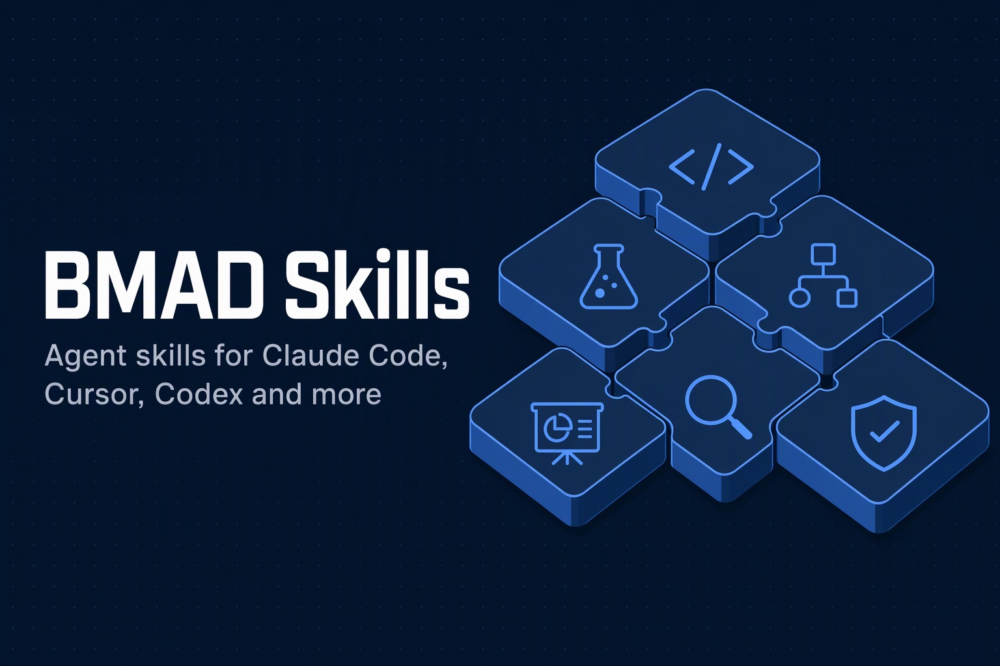

<p align="center">
  
</p>

<p align="center">
  <a href="https://github.com/bmad-labs/skills/actions/workflows/skill-security-pr.yml"></a>
  <a href="https://github.com/bmad-labs/skills/actions/workflows/skill-security-audit.yml"></a>
  <a href="LICENSE"></a>
  <a href="#available-skills"></a>
  <a href="https://github.com/bmad-labs/skills/stargazers"></a>
</p>

<p align="center">
  <a href="https://skills.sh/bmad-labs/skills"></a>
  
  
  
  
  <a href="CONTRIBUTING.md"></a>
</p>

<p align="center">
  <a href="#quick-start">Quick start</a> ·
  <a href="#available-skills">Skills</a> ·
  <a href="#installation">Installation</a> ·
  <a href="#security">Security</a> ·
  <a href="#creating-new-skills">Contributing</a>
</p>

# BMAD Skills

A collection of agent skills that give Claude Code, Cursor, Codex, OpenCode and 20+ other agents specialized knowledge and workflows: architecture design, testing, clean code, release automation, incident analysis, documents, slides and more.

## Quick start

```bash
npx skills add bmad-labs/skills
```

Then describe the task. The agent loads the matching skill on its own, or you call one directly with `/skill-name`.

## What are Skills?

Skills are self-contained instruction sets that teach an agent how to perform specialized tasks. Each skill is defined in a `SKILL.md` file with optional supporting resources like scripts, templates, and reference documentation.

## Repository Structure

```
<root>/
├── skills/                  # All skill implementations
│   └── [skill-name]/        # Individual skill folder
│       ├── SKILL.md         # Required - Main skill definition
│       ├── scripts/         # Optional - Supporting scripts
│       ├── references/      # Optional - Reference documentation
│       └── assets/          # Optional - Images, resources
├── template/                # Starter template for new skills
├── spec/                    # Skills specification documentation
├── CONTRIBUTING.md          # Contribution guidelines
└── README.md                # This file
```

## Installation

### Method 1: Install via skills CLI (Recommended)

The easiest way to install skills using the [`skills`](https://www.npmjs.com/package/skills) package. Supports Claude Code, Cursor, Codex, OpenCode, and [20+ other agents](https://www.npmjs.com/package/skills#available-agents).

```bash
# Install all skills
npx skills add bmad-labs/skills

# Install specific skills for TypeScript development
npx skills add bmad-labs/skills --skill typescript-clean-code --skill typescript-e2e-testing --skill typescript-unit-testing

# Install to specific agent (e.g., claude-code, cursor, codex)
npx skills add bmad-labs/skills -a claude-code

# Install globally (user-level, available in all projects)
npx skills add bmad-labs/skills -g
```

### Method 2: Install via Plugin Marketplace

This method installs the entire plugin with all skills automatically detected.

**Step 1: Add the marketplace**
```bash
/plugin marketplace add bmad-labs/skills
```

**Step 2: Install the plugin**
```bash
/plugin install bmad-skills@bmad-skills
```

**Step 3: Verify installation**
```bash
# Open the plugin manager to see installed plugins
/plugin

# Or ask Claude: "What skills are available?"
```

### Method 3: Install via settings.json

Add to your project's `.claude/settings.json`:

```json
{
  "extraKnownMarketplaces": {
    "bmad-skills": {
      "source": {
        "source": "github",
        "repo": "bmad-labs/skills"
      }
    }
  },
  "enabledPlugins": {
    "bmad-skills@bmad-skills": true
  }
}
```

### Method 4: Install Individual Skills

If you only need specific skills, add them individually to your project's `.claude/settings.json`:

```json
{
  "skills": [
    "github:bmad-labs/skills/skills/typescript-clean-code",
    "github:bmad-labs/skills/skills/typescript-e2e-testing",
    "github:bmad-labs/skills/skills/typescript-unit-testing"
  ]
}
```

**Available skill paths:**
- `github:bmad-labs/skills/skills/architecture-design`
- `github:bmad-labs/skills/skills/architecture-viz-studio`
- `github:bmad-labs/skills/skills/bmad-leader`
- `github:bmad-labs/skills/skills/book-converter`
- `github:bmad-labs/skills/skills/close-loop-dev-setup`
- `github:bmad-labs/skills/skills/create-intent`
- `github:bmad-labs/skills/skills/github-sync`
- `github:bmad-labs/skills/skills/jira-to-local`
- `github:bmad-labs/skills/skills/load-docs`
- `github:bmad-labs/skills/skills/manual-testing`
- `github:bmad-labs/skills/skills/mcp-builder`
- `github:bmad-labs/skills/skills/multi-repo-git-ops`
- `github:bmad-labs/skills/skills/rca-report`
- `github:bmad-labs/skills/skills/release-please`
- `github:bmad-labs/skills/skills/skill-from-book`
- `github:bmad-labs/skills/skills/slide-maker`
- `github:bmad-labs/skills/skills/to-markdown`
- `github:bmad-labs/skills/skills/to-wiki`
- `github:bmad-labs/skills/skills/trade-off-analysis`
- `github:bmad-labs/skills/skills/typescript-clean-code`
- `github:bmad-labs/skills/skills/typescript-e2e-testing`
- `github:bmad-labs/skills/skills/typescript-unit-testing`
- `github:bmad-labs/skills/skills/ultrathink-protocol`

### Troubleshooting

If skills are not detected after installation:

1. **Clear the plugin cache:**
   ```bash
   rm -rf ~/.claude/plugins/cache
   ```

2. **Restart Claude Code** (exit and run `claude` again)

3. **Verify skills are loaded:**
   - Ask Claude: "What skills are available?"
   - Or run `/plugin` and check the **Errors** tab

4. **Check plugin structure:**
   ```bash
   claude plugin validate .
   ```

## Using Skills

### Invoking a Skill

Once installed, you can invoke skills using the slash command format:

```
/skill-name [arguments]
```

Or simply describe what you need - Claude will automatically use relevant skills based on their descriptions.

## Creating New Skills

1. Copy the `template/` folder to `skills/your-skill-name/`
2. Edit `SKILL.md` with your skill definition
3. Add any supporting scripts or references
4. Test the skill locally
5. Submit a PR

See [CONTRIBUTING.md](CONTRIBUTING.md) for detailed guidelines.

## Skill Categories

| Category | Description |
|----------|-------------|
| Development | Coding, architecture, testing, DevOps |
| Productivity | Documents, project management, workflows |

## Available Skills

### Development

| Skill | Description |
|-------|-------------|
| [architecture-design](skills/architecture-design) | Build a design package (C4, ERD, domain events, ingress/egress APIs, sequence, class, state, pipeline diagrams) at high, medium, or low detail — single-source contracts, every protocol file proven by a real validator, one folder at a time |
| [architecture-viz-studio](skills/architecture-viz-studio) | Build animated Three.js + GSAP architecture visualizations — cinematic scroll-story pages and interactive architecture maps with switchable lenses, drill-down diagrams, and ERDs |
| [bmad-leader](skills/bmad-leader) | Drive a long-running BMAD build session — plan, dispatch bmad-build subagents per story, approve gates, verify, and report progress |
| [close-loop-dev-setup](skills/close-loop-dev-setup) | Set up a minimal drive-and-observe loop so an agent can validate user-visible behavior the way a human would — browser/desktop harness, screenshots, vision checks |
| [manual-testing](skills/manual-testing) | Plan, write, review, execute, and maintain manual test cases — API/backend, frontend, pipeline, AI/LLM, and infrastructure testing with risk-based prioritization |
| [mcp-builder](skills/mcp-builder) | Guide for creating high-quality MCP servers for LLM integrations |
| [multi-repo-git-ops](skills/multi-repo-git-ops) | Git operations across multi-repo systems with submodules — branching, committing, pushing, syncing across parent and service repos |
| [rca-report](skills/rca-report) | Investigate and document production incidents — guides evidence collection during the investigation and produces rich, reproducible Root Cause Analysis reports with layered root cause, workaround playbook, Five Whys, and binned recommendations |
| [release-please](skills/release-please) | Automated versioning and releases with Google's release-please — pipeline setup, Conventional Commits, pre-releases, monorepos |
| [skill-from-book](skills/skill-from-book) | Convert book content into structured Claude Code skills |
| [typescript-clean-code](skills/typescript-clean-code) | Clean Code principles and workflows for TypeScript development |
| [typescript-e2e-testing](skills/typescript-e2e-testing) | Comprehensive E2E testing for TypeScript/NestJS with Kafka, PostgreSQL, MongoDB, Redis |
| [typescript-unit-testing](skills/typescript-unit-testing) | Unit testing for TypeScript/NestJS with Jest, DeepMocked, mongodb-memory-server, pg-mem, Kafka, Redis |
| [ultrathink-protocol](skills/ultrathink-protocol) | Structured root-cause investigation protocol for complex, multi-layer problems that have resisted repeated fix attempts |

### Productivity

| Skill | Description |
|-------|-------------|
| [book-converter](skills/book-converter) | Convert EPUB books to formatted Markdown |
| [create-intent](skills/create-intent) | Turn Jira stories or raw requirement notes into traceable business intent docs — intent, FR with AC, NFR, reading log — plus sourced questions split for the PO and the tech lead, with a consistency check script |
| [github-sync](skills/github-sync) | Bidirectional sync between BMAD planning artifacts and GitHub Projects v2 — push stories, pull status, onboard projects, manage boards |
| [jira-to-local](skills/jira-to-local) | Pull a Jira issue onto disk as readable local files — fields, comments, subtasks, worklogs, images, dev panel, and any linked Confluence page; read-only, markdown or JSON output |
| [load-docs](skills/load-docs) | Load documents (files, folders, URLs, PDFs) fully into the main agent's context for follow-up Q&A, summarization, or review |
| [slide-maker](skills/slide-maker) | Design-system-agnostic slide/deck maker — brainstorm, generate, and export to editable PPTX, image PPTX, standalone HTML, or PDF; 34 token-driven layouts, bundled neutral theme, works with your design system or a suggested one |
| [to-markdown](skills/to-markdown) | Faithful PDF/DOCX/slide-deck to Markdown transcription — verbatim prose, LaTeX equations with source numbers, tables as Markdown rows, real cropped figures, page provenance, and a multi-lens subagent review |
| [to-wiki](skills/to-wiki) | Turn a transcribed source into a Karpathy-style LLM wiki — concept, entity, source, and synthesis pages with index, append-only log, and schema; every claim anchored to raw text, no outside knowledge, gated by independent reviewers |
| [trade-off-analysis](skills/trade-off-analysis) | Structured technology trade-off analysis with scored comparison matrices for architecture decisions, build-vs-buy, and technology selection |

## Security

Every skill is checked before and after it ships:

- **On each pull request** — the [Skill checks](.github/workflows/skill-security-pr.yml) workflow validates `SKILL.md` frontmatter and runs [Snyk Agent Scan](https://github.com/snyk/agent-scan) on each changed skill. Reviewed, accepted risks are recorded per skill with a reason in [`.github/snyk-agent-scan-allow.json`](.github/snyk-agent-scan-allow.json).
- **Nightly** — the [skills.sh security audit](.github/workflows/skill-security-audit.yml) workflow reads the published [skills.sh](https://skills.sh/bmad-labs/skills) results from Gen Agent Trust Hub, Socket and Snyk, and fails on a HIGH or CRITICAL finding.

Found a security issue in a skill? Please open an issue or a pull request.

## Recommended Skills from Other Repositories

Expand your Claude Code capabilities with these excellent skills from the community:

### Vercel Labs Skills

```bash
# Install agent-browser skill for browser automation
npx skills add vercel-labs/agent-browser

# Install React best practices skill
npx skills add vercel-labs/agent-skills --skill vercel-react-best-practices

# Install all recommended skills at once
npx skills add vercel-labs/agent-browser && \
npx skills add vercel-labs/agent-skills --skill vercel-react-best-practices
```

| Repository | Skill | Description |
|------------|-------|-------------|
| [vercel-labs/agent-browser](https://github.com/vercel-labs/agent-browser) | agent-browser | Browser automation and web interaction capabilities |
| [vercel-labs/agent-skills](https://github.com/vercel-labs/agent-skills) | vercel-react-best-practices | React development best practices and patterns |

## License

MIT License - See individual skills for specific licensing.
