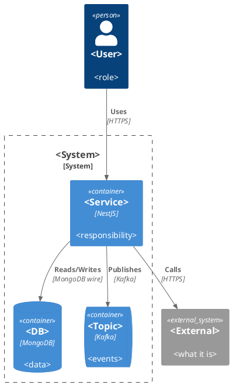

# PlantUML Recipes

Use for sequence, class, state, ERD, activity, and
any graph past ~10 nodes, or whenever hand SVG is not the pick (SKILL.md §Diagrams).

## Decompose, don't cram

One diagram makes **one thing** obvious in about five seconds. Past ~10 nodes or ~15 arrows it fails.

- **Overview + drill-downs** (flows, sequences): an overview of ≤ 10 phases; each complex phase gets its own
  detail diagram, named the same, and the overview node says `(see 04)`.
- **Split by concern** (classes): behaviour (controllers, use cases, handlers, ports) in one diagram; data shapes
  (entities, DTOs, enums) in another.

If a diagram grows past the budget, split it. Do not shrink the font.

## Shared style file

Put the preamble in one `_style.iuml` per folder and start each diagram with:

```plantuml
@startuml <file-stem>
!include _style.iuml
title <NN> — <what this diagram shows> (<requirement ids>)
```

Name the diagram after its file so the SVG gets the same name.

### House preamble (C4, component, ERD, state, activity)

```plantuml
skinparam backgroundColor #FFFFFF
skinparam defaultFontName Arial
skinparam defaultFontSize 12
skinparam shadowing false
skinparam roundCorner 10
skinparam ArrowColor #455A64
skinparam ArrowFontColor #455A64
skinparam ArrowThickness 1.2
' Pastel fills: #E8F5E9 green, #E3F2FD blue, #FFF3E0 orange, #F3E5F5 purple; border #B0BEC5
```

Rules: no `diamond` shape (use `if` in activity, or `<<decision>>`); pastel fills, grey borders; a `legend` when
two or more colours carry meaning.

## C4 container



≤ 9 boxes inside the boundary. Every `Rel` has intent + protocol. Request direction only.

## Component (module map)

```plantuml
package "<service>" {
  [<module A>] as a
  [<module B>] as b
  [shared domain] as d
}
a --> b : <Command> (CommandBus)
a --> d : uses
```

Arrows carry the verb and the mechanism. Colour by origin (new / existing / store) with a legend.

## ERD

```plantuml
@startuml erd
!include _style.iuml
entity "orders" as O {
  *_id : ObjectId <<PK>>
  --
  *customerId : ObjectId <<FK>>
  shipping (country, postalCode)
  status
}
entity "customers" as C {
  *_id : ObjectId <<PK>>
  --
  defaultAddressId : ObjectId <<FK>>
}
C ||--o{ O : "places"
@enduml
```

Key fields and relation fields only; the full shape is in the `.jsonc`. No `{}` inside an entity body.

## Class (one per module)

Colour by role with stereotypes in `_style.iuml`, and a shared `_legend.iuml`:

```plantuml
skinparam classAttributeIconSize 0
hide empty members
hide circle
skinparam class<<controller>> {
  BackgroundColor #E3F2FD
}
skinparam class<<usecase>> {
  BackgroundColor #FFF3E0
}
skinparam class<<command>> {
  BackgroundColor #F3E5F5
}
skinparam class<<handler>> {
  BackgroundColor #F3E5F5
}
skinparam class<<port>> {
  BackgroundColor #E8F5E9
}
skinparam class<<rule>> {
  BackgroundColor #F1F8E9
}
skinparam class<<model>> {
  BackgroundColor #ECEFF1
}
skinparam class<<event>> {
  BackgroundColor #FCE4EC
}
skinparam class<<adapter>> {
  BackgroundColor #FFEBEE
}
skinparam class<<entity>> {
  BackgroundColor #E8EAF6
}
```

```plantuml
package "Application layer — src/modules/<module>" {
  class PlaceOrderUseCase <<usecase>> {
    +execute(req: PlaceOrderRequest, scope): Promise<PlaceOrderResponse>
    ..uses..
    OrderRepository, OrderStatusMachine
    ..sends..
    ReserveStockCommand
  }
}
PlaceOrderUseCase ..> ReserveStockCommand : CommandBus
```

Signatures only. List the ports a class uses inside its box; draw arrows only for control flow. Solid = calls;
dashed = sends a command, publishes, or creates. A class from another module is drawn once, labelled
`"<module>\n<Class>"`.

## Sequence

Own style, not the house preamble. Put this in `07-sequences/_style.iuml`:

```plantuml
!theme plain
skinparam backgroundColor #FEFEFE
skinparam shadowing false
skinparam defaultFontName Arial
skinparam defaultFontSize 12
skinparam maxMessageSize 260
skinparam sequence {
    ArrowThickness 2
    ParticipantBorderThickness 2
    LifeLineBorderColor #888888
    DividerBackgroundColor #F0F0F0
    GroupBodyBackgroundColor #FFFFFF80
    GroupBackgroundColor #ECEFF1
    GroupBorderColor #90A4AE
}
skinparam NoteBackgroundColor #FFFDE7
skinparam NoteBorderColor #E6D77A
' Activation bar colours by role
!$CTL = "#C5CAE9"
!$UC = "#A5D6A7"
!$SVC = "#E1BEE7"
!$REPO = "#80CBC4"
!$DB = "#FFE0B2"
!$PUB = "#B39DDB"
!$EXT = "#EF9A9A"
```

Skeleton:

```plantuml
@startuml 01-confirm-order
!include _style.iuml
title 01 — Confirm order (FR-1)

box "Client" #E8EAF6
    actor "User" as U
    participant "Frontend" as FE
end box
box "<module>" #E8F5E9
    participant "Controller" as C
    participant "UseCase" as UC
end box
box "Storage" #FFF3E0
    database "MongoDB" as DB
end box
box "External" #FFEBEE
    participant "<API>" as X
    queue "Kafka" as K
end box

U -> FE : Submit
activate FE $CTL
FE -> C : ConfirmOrder {orderId, version}
activate C $CTL
C -> UC : execute(request, scope)
activate UC $UC

== Check ==
UC -> DB : load order
activate DB $DB
DB --> UC : order
deactivate DB
note right of UC
  Refuse: ORDER_VERSION_STALE, ORDER_NOT_OWNER
end note

== Send ==
group one transaction
    UC -> DB : save
    activate DB $DB
    DB --> UC : committed
    deactivate DB
end
UC -> K : ORD102 (after commit)
UC --> C : response
deactivate UC
C --> FE : 200
deactivate C
FE --> U : result
deactivate FE
@enduml
```

Rules:
- Manual `activate X $COLOR` / `deactivate X`, never `autoactivate`. Every activate has its deactivate; nested
  calls unwind inside-out. Self-messages need none. An outer bar may stay open across a flow; say so.
- Zones as coloured `box` by tier, ≤ ~5 participants each: client indigo `#E8EAF6`, our module green `#E8F5E9`,
  shared domain purple `#F3E5F5`, storage orange `#FFF3E0`, external red `#FFEBEE`.
- `== Phase ==` dividers for each stage. `group one transaction` for one database transaction.
- One yellow note per step for the rule or error codes that matter. No inline colour on notes.
- Every arrow has a label; returns are dashed (`-->`). Concurrency is `par … else … end`, never `loop`.

## State

```plantuml
@startuml order-states
!include _style.iuml
[*] --> placed : PlaceOrder (ORD101)
placed --> paid : gateway accepted (ORD102)
placed --> payment_failed : gateway failed or timeout (ORD103)
payment_failed --> placed : RetryPayment
paid --> [*]
@enduml
```

`[*]` start and end. Every transition labelled with its trigger (and event code).

## Activity (main flow, workflow)

```plantuml
@startuml main-flow
!include _style.iuml
start
:Receive <trigger>;
if (<decision>?) then (yes)
  :Branch A;
else (no)
  :Branch B;
endif
:Persist;
:Publish <event>;
stop
@enduml
```

≤ 12 activity nodes. Use `partition "<phase>"` to group.

## Render and check

```sh
plantuml -tsvg -failfast2 *.puml
```

Render success proves syntax only. Review the flow against the module design and the API files.
