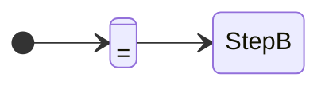

# <Product / Feature> — State Definitions

<Number> status fields of <record>: **<Field 1>**, **<Field 2>**. This page defines each field and shows its value at each step of the workflow.

Optional document: write it when the sources use status fields, stages, or tabs.

**Source tags:**

| Tag | Meaning |
| --- | --- |
| **S** | Story text. |
| **D** | Decision (answer or comment; see [memlog.md](memlog.md)). |
| **P** | Our proposal, waiting for approval ([confirm-po.md](confirm-po.md) G#). |
| **?** | Open. No source defines it yet. |

`—` = field has no value at this step.

## 1. Field definitions

### 1.1 <Field>

<What it means.> Level: <record / item>.

| Value | Meaning | Tag | Source |
| --- | --- | --- | --- |
| `<value>` | <meaning> | S | <KEY ACn> |

## 2. Values through the workflow

| # | Step | Tab / menu | <Field 1> | <Field 2> |
| --- | --- | --- | --- | --- |
| 1 | <event> | <where it shows> [tag] | `<value>` [tag] | no change |

### Main path

Validate the diagram before saving (Mermaid validator tool, if available).

## 3. Open points on states

| # | Point | Where to answer |
| --- | --- | --- |
| 1 | <conflict or missing value> | confirm-po Q# / G# |
