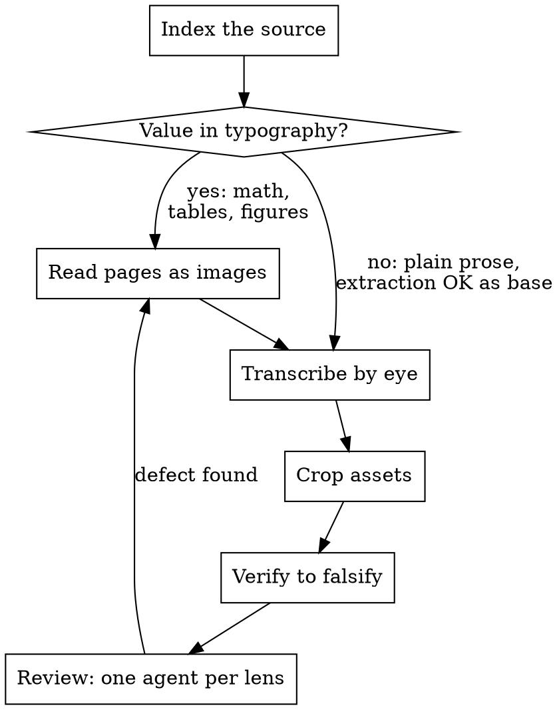

# Faithful Document → Markdown

## Overview

A conversion is a **transcription**, not a summary and not a rewrite. The output stands in for the
source: someone will cite it, grep it, and trust its numbers without reopening the original.

**Core principle: machine text extraction sets the quality ceiling.** `pdftotext` and friends
destroy exactly what makes a technical document worth converting — fractions collapse to
`1 X x¯k`, table rules vanish, captions merge into body prose, and upright-vs-italic distinctions
disappear. No cleanup pass recovers information that extraction already threw away.

So: **read the rendered page.** Use extraction only as a cheap index (where things are), never as
the source of truth for what things say.

## When to Use

- Source has equations, tables, multi-panel figures, or numbered cross-references.
- Output must be greppable, diffable, or citable — going into a repo, a knowledge base, a wiki.
- Someone will rely on a number in the output without checking the source.
- Reviewing or repairing an existing conversion.

**When NOT to use:**
- You need the *gist* → just read the PDF and answer. Don't convert.
- Plain prose with no structure, and nobody will cite it → `pdftotext -layout` is fine.
- The source is already Markdown, HTML, or LaTeX → convert the markup directly.

## The Output Contract

Every conversion produces these parts. Not guidelines — the shape of the deliverable.

| Part | Content |
|---|---|
| **Body files** | Source prose **verbatim**. Reflowed line breaks; headers and page numbers removed. |
| **Real assets** | Every figure as an actual image file, cropped from the rendered page. |
| **Structured data** | Every table as **Markdown rows**. Never an image. |
| **Math** | Every equation as LaTeX, carrying the source's own equation number. |
| **Provenance** | Per file: source path + page range. Globally: the page-offset rule. |
| **Index** | Nav, plus a figure/table inventory with source pages. |

### Verbatim means verbatim

Preserve the author's errors. Typical examples: *"the results shows"*,
*"this approachs are sensitive"*, *"implementation the module"*, *"seperate layers"*.

Silently fixing these corrupts the reference — a later reader quoting your version misquotes the
author. If a typo genuinely blocks comprehension, keep it and add `[sic]`.

**House style does not apply to quoted material.** If your project mandates a writing style
(terse, plain-language, a controlled-language standard), it governs text *you* author — the index, provenance, reference
cards. The transcribed source keeps its own voice. Rewriting someone's thesis into your house
style produces a paraphrase, not a reference.

### Never fabricate an asset

If the source has a screenshot, extract the screenshot. Hand-typing ASCII or emoji art to imitate
it presents invented content as source content — the single worst outcome here, because it looks
fine and is unfalsifiable without the original. Same for redrawing a diagram from memory or
describing a photo in prose where the figure belongs.

Can't crop it? Say so in the output. An honest gap beats a convincing fake.

## Process



**1. Index the source.** Page count, page size, producer, text-layer presence, per-page image
counts, caption positions. This is what extraction is *for*. Establish the page-offset rule early
(`PDF page = printed page + N`) — front matter almost always makes these differ.

**2. Read pages as images.** `Read` with `pages` (20 max per call). Batch by chapter, not by
arbitrary page count — batching across a chapter boundary is how page attributions get mixed up.

**3. Transcribe by eye.** Per chapter. Keep the source's own section numbering. Reflow LaTeX line
wraps into whole paragraphs. Drop running headers and page numbers.

**4. Crop assets.** Derive the box from caption position + text-block layout, render at 200 dpi.
The crop's bottom edge goes **above** the caption — the caption belongs in the Markdown as text,
not baked into pixels where it cannot be searched or corrected. Assert it (`y1 = caption.y0 - 2`)
rather than eyeballing it; a caption inside the frame still looks right.
See [references/cropping.md](references/cropping.md) for the PyMuPDF recipe, including two figures
sharing one page.

**5. Verify so that failure is possible.** See below.

**6. Review along independent dimensions.** One subagent per lens, all dispatched in one
message. This step is separate from step 5 and is not satisfied by it: step 5 checks what your
own checks can represent, step 6 covers what they are structurally blind to.

A review is these four parts, in this order:

1. **Write the coverage table before you dispatch anything.** One row per output file you
   produced, with the lens that will cover it. Every row gets a lens name.

   | output file | lens |
   |---|---|
   | 01-introduction.md | prose + tables |
   | 03-methods.md | prose + math |
   | table-3.md | tables |
   | bibliography.md | bibliography |

   Your own transcription is the largest part of this table. In the run that produced this
   skill, 17 of 26 real defects were in body prose the converter wrote and had already
   checked, and 6 more were glyph-level cells no serial check can represent — every one in a
   file the converter had marked green.

2. **Each content kind gets its own lens and its own agent** — prose, math, tables, figures,
   bibliography, structure. A lens covers its kind in every file, whoever produced it.
3. **Each agent returns a file** — one row per item, a verdict column, and a column naming the
   distinctive thing it confirmed. Fixed row count, stated up front.
4. **Score the returned rows against a key you derived yourself**, then spot-check rows by hand.

Whoever wrote a section cannot be its reviewer. You authored everything you transcribed, so
your own verification is authorship — it never converts a file into a reviewed file.


## Verification That Can Falsify

A check that cannot fail proves nothing. Each of these can:

| Claim | Falsifiable check |
|---|---|
| Figure crop is right | **Open every PNG.** Panels present, nothing clipped, no other figure bleeding in. |
| Equation is right | Re-read the source page image; compare accent, symbol class, operator. |
| Table is right | Cell by cell against the printed grid. |
| Numbers are right | Regex every measurement/percentage from the source; confirm each in the output. |
| Page ranges are right | Range start must be that chapter's opening page; the page after the end must be the next chapter. |
| Links resolve | Every anchor targets a real heading; no orphaned assets. |
| Nothing dropped | Harvest source sentences; check each appears in the output. |

**Open every image file you produced.** Not a sample. This is the only check that catches a wrong
or clipped crop, and it is cheap.

### Your checkers will lie to you

Text-diff checkers produce false positives constantly against a faithful conversion — nested
citation links (`[[7]](bib.md#7)` vs the source's `[7]`), LaTeX in `$$` blocks, figure-internal
labels, digits inside filenames. In one ~70-page conversion, an automated pass flagged **99
"missing" sentences; all 99 were artifacts.**

So: **read every flagged match by hand before believing it.** Report automated counts as
*suspects*, never as defects. Use a control — a chapter with no citations and no equations should
diff nearly clean; if it doesn't, your checker is broken, not the conversion.

## Reviewing With Subagents

This is step 6 above. One agent per lens, dispatched in one message so they run concurrently.
A single pass told to watch everything watches nothing.

**Choose the dimensions from what the source actually contains** — do not run a fixed list. For
each kind of content present, ask: *if this were silently wrong, would a reader be misled?* Yes →
it earns a lens. Split so each agent has one source of truth. Aim for 2–5.

Common ones: **Fidelity** (verbatim text, numbers, author typos) · **Math** (accents, symbol
class, operators) · **Structure** (TOC, links, references, provenance ranges) · **Figures** (open
every image) · **Code & signatures** (for manuals). A datasheet needs electrical values and
register tables instead; a spec needs normative wording and clause numbering.

Checklists, TSV columns, scoring rules, dispatch template:
[references/review-dimensions.md](references/review-dimensions.md).

Step 6's wording was arrived at by measurement; the arms, scores, and baseline rationalizations
are in [references/step-6-test-record.md](references/step-6-test-record.md). Re-run those arms
before you edit step 6.

### Demand an artifact, not a verdict

This is the whole difference between delegation that works and delegation that wastes an hour.

Measured, same conversion, same task:

- **Asked for a prose report** → four review agents, three rounds of requests, **zero findings
  delivered**. All four reviews had to be redone by hand.
- **Asked for a TSV file, one row per equation, `CORRECT`/`DEFECT` + page + the distinctive symbol
  confirmed** → **12/12 rows, 0 page-attribution errors**, every marker matching an independently
  derived key.

A prose verdict is unfalsifiable and easy to abandon mid-task. A required file with a fixed row
count is checkable, and you can score it against your own spot-checks. So specify: exact output
path, exact columns, one row per item, and a field that forces evidence (*which symbol did you
confirm?*) rather than a bare pass/fail.

Then **spot-check the artifact yourself** on a few rows. Delegation gives you parallel coverage,
not permission to skip looking.

### What not to delegate

The final judgment that a figure crop is right. Opening the PNG is seconds of work and the failure
mode (plausible-looking but clipped, or caption baked in) is exactly what a summarised report
hides.

## Quick Reference

```bash
# Index (extraction is fine here — you want locations, not content)
pdfinfo doc.pdf
pdfimages -list doc.pdf | awk '{print $1}' | sort -nu   # pages holding images
python3 -c "import fitz;d=fitz.open('doc.pdf');[print(i+1,d[i].search_for('Figure')) for i in range(len(d))]"

# Read rendered pages (the source of truth)
# Read tool, pages: "21-40"   — 20 max per call

# Crop at 200 dpi
python3 -c "import fitz;d=fitz.open('doc.pdf');d[4].get_pixmap(matrix=fitz.Matrix(200/72,200/72),clip=fitz.Rect(72,100,540,400)).save('fig.png')"
```

## Common Mistakes

| Mistake | Why it fails | Instead |
|---|---|---|
| Table shipped as a PNG | Not greppable, diffable, or accessible — defeats the conversion | Transcribe to Markdown rows |
| Typed ASCII art for a screenshot | Fabrication presented as source | Crop the real image, or state the gap |
| Equations from `pdftotext` | Fractions and accents already destroyed | Write LaTeX from the rendered page |
| Verified by reading your own output | Cannot detect drift from source | Compare against the source page |
| Page range from memory of a batch | Silent misattribution | Boundary-check every range |
| Author's typo "cleaned up" | Later readers misquote the author | Keep verbatim; `[sic]` if needed |
| Own verification treated as the review | Your checks find only what they can represent | Step 6: point a lens at your own files too |
| Producer subagent's self-report accepted | A producer auditing itself reports the artifact it believes in | Review it with an agent that did not write it |
| House writing style applied to quoted prose | Produces a paraphrase | Style governs your text, not theirs |
| Trusting a diff script's flag count | Mostly citation/math artifacts | Read every flag by hand |

## Two Defects This Skill Exists To Prevent

Both observed in real runs, both invisible to a casual review:

**Page ranges wrong in 5 of 7 files.** Cause: page reads batched across chapter boundaries, then
attributions written from memory rather than checked. Every range looked plausible. Only the
boundary assertion caught it — hence its place in the verification table.

**Structured content silently degraded.** Given a hard table or a screenshot, agents ship a PNG of
the table or hand-type ASCII art for the screenshot. Both produce output that reads as complete.
The output contract exists because the failure is one of *shape*, and shape is what a plausible
result hides.
