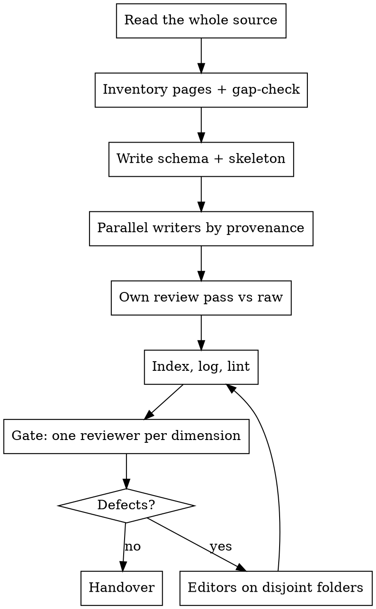

# Source → LLM Wiki

## Overview

A wiki is a **second layer over an immutable raw source**. Raw stays verbatim in `docs/references/`.
The wiki holds hand-written pages that summarize, cross-link, and synthesize, and every fact in it
points at the raw line it came from.

**Core principle: the wiki may only know what the source says.** If a fact is not in the raw text,
the wiki does not state it. The only place an absent topic may appear is a `## Not covered by the
source` list at the end of a concept page. That list is the valve that keeps writer knowledge out.

A wiki built without that valve fills with plausible outside facts within pages. Measured in the
baseline for this skill: the writer defined a `Background` tag, "true, standard, and not in the
source", and used it on the first method page.

## When to Use

- Raw source already transcribed to Markdown (use `to-markdown` first if not).
- Output will be queried by agents and people later, and will grow as more sources are ingested.
- Someone will trust a number or a claim from a wiki page without reopening the raw file.
- An existing wiki needs an ingest, a query answered from it, a lint, or a pre-handover review.

**When NOT to use:** one-off question about a document → read it and answer. Notes for one
session → a scratch file. Source not yet in Markdown → `to-markdown` first.

## The Output Contract

Not guidelines. The shape of the deliverable.

| Part | Content |
| --- | --- |
| `AGENTS.md` | Schema: layout, hard rules, link paths, frontmatter, page templates, index and log formats, ingest / query / lint workflows, frozen slug list |
| `index.md` | One line per page, grouped by type, alphabetical. Loaded first by any agent |
| `log.md` | Append-only, dated entries: `ingest`, `query`, `lint`. Newest at bottom |
| `sources/` | One page per raw document, plus one per chapter. Section-by-section map with anchors, equations table, figures table, numbers table, citations table |
| `concepts/` | One idea per page. Ends with mandatory `## Not covered by the source` |
| `entities/` | People, orgs, hardware, software, papers, deployments. An index into the source: `## Every mention` bullets, not an encyclopedia article |
| `syntheses/` | Cross-page answers: comparisons, equation index, figure index, key numbers, lessons, contributions map, open problems |

Page rules that are non-negotiable, in the schema and on every page:

1. **Every claim sentence carries an inline relative link to its raw section anchor.** A page-level
   "Source lines" footer is not enough. Baseline: one footer-only page had 96 unanchored sentences
   and one invented count ("five of six") that the footer could not have caught.
2. **A citation clause is all you get.** If the source gives a cited work only a number and a clause,
   the wiki gets only that clause. No method summary from memory.
3. Numbers exact, with units. Equations copied byte-exact with the source's own tag.
4. Cross-link on first mention. At least 3 outgoing wiki links per page. Relative Markdown links only.
5. Figures link into raw assets. Never copy images.
6. Where the source is silent, write "the source does not say". Where the wiki draws a connection
   the source does not draw, label it "wiki reading".
7. Pages hold latest state. History goes to `log.md`.
8. **Entity threshold.** An entity page exists only for a work, person, or thing the source describes
   in more than one clause or gives a role. A work cited once stays a row in the source page's citations
   table. On a review with ~180 references this rule removes most stub pages.

Template for the schema file, ready to adapt: [references/schema-template.md](references/schema-template.md).

## Process

**1. Read the whole source yourself.** All chapters, bibliography, reference cards. The inventory
you design next is only as good as your recall of what is in the text.

**2. Inventory the pages, then gap-check the inventory.** Choose the shape for this kind of
source first, with [references/structure-selection.md](references/structure-selection.md): what
earns an entity page, which syntheses are mandatory, how the concept template changes, which gate
lenses run. Then draft slugs per type. Then dispatch one planning agent with the draft and the raw paths, and ask for: topics the source states that no
page covers, pages to merge (too thin) or split (too fat), pages that will tempt outside knowledge,
and a batch split by chapter provenance. In the run that produced this skill the gap-check added
10 pages (a method step, test setup, dataset, committee members, a cited-work entity), merged
6, split 2, and named 10 risk pages that later got sentence-by-sentence review.

**3. Write the schema and skeleton first.** `AGENTS.md` with every rule above and the **frozen
slug list**. Empty `index.md` with type headings. `log.md` header. Writers link against the frozen
slugs, so cross-batch links do not dangle.

**4. Parallel writers, split by chapter provenance, never by folder.** One writer per chapter
group, so no two writers need the same raw section open. Each gets the schema, the frozen slug
list, its own slugs with one-line intent each, and the raw files to read. Nobody touches
`index.md` or `log.md`. Each returns its index lines in its final message. Model: `opus`.

**5. Read every page yourself against its raw anchors.** Look for: numbers, outside knowledge on
the risk pages, inferences stated as fact, ambiguous dropped articles, template compliance. This
pass is authorship. It does not replace step 7.

**6. Assemble index and log. Lint.** Broken links, bad anchors, frontmatter, index coverage, title
match, minimum links, `Not covered` present, encoding. Shell one-liners in
[references/lint.md](references/lint.md). No generator scripts, no checker scripts inside the wiki.

**7. Gate: one reviewer per dimension, before any handover.** See below. Required.

**8. Editors on disjoint folders, then lint again, then log.** Style and consistency fixes are
large. Two `opus` editors, one per folder pair, with hard rules: no fact, number, link, heading,
or quoted text changes. Then re-run step 6 and append a `lint` entry to `log.md`.

## The Gate

Your own read in step 5 is authorship, not review. Measured in the run that produced this skill,
**after** a full own-read of 71 pages that fixed 9 issues, five independent reviewers found:

| Dimension | Found after own review |
| --- | --- |
| Fidelity vs raw | 1 elided caption clause in 3,300 checked claims |
| Outside-knowledge leaks | 0 facts, 3 inferences stated as fact, 7 weak connectives |
| Schema compliance | 5 template gaps, 1 index title mismatch, 1 unanchored claim |
| Reader queries (24 questions, 3 personas) | 24 answered, 10 usability gaps |
| Style and consistency | 9 ambiguous sentences, 45 long, 120 passives, 24 idioms, 1 contradiction |

Not one of those was visible to lint or to the author. So the gate is a required step with a fixed
shape, not a judgment call:

1. **Pick dimensions from what the wiki contains.** Default five above. A wiki with no equations
   drops the equation checks; a wiki with code adds a code lens.
2. **One reviewer per dimension, read-only, `opus`, all dispatched in one message**, each with the
   checklist for its dimension from [references/gate-review.md](references/gate-review.md).
3. **Demand a report shape:** `CHECK n — PASS|FAIL (x issues)` per checklist item, then
   `path:line | "text" | fix` per issue, then counts. A prose verdict is not a report.
4. **Reports truncate.** When a report ends mid-check, send the reviewer a message asking for the
   missing checks only, under a line budget. Do not guess the tail.
5. **Triage yourself.** Verify each HIGH item against raw before acting. Accept by-design
   duplication (entity "Every mention" pages quoting the same sentence) and record the acceptance
   in `log.md`.
6. Fix, re-lint, log, then hand over with the table of what was checked and what remains unverified.

### Rationalizations that skip the gate

All heard in the baseline for this skill. All mean: run the gate.

| Excuse | Reality |
| --- | --- |
| "I already read every page against raw" | Own read fixed 9. Reviewers then found 30+. Authorship is not review. |
| "Marginal find rate is low now" | Find rate of the author is low. Find rate of a fresh lens is not. |
| "Lint is green" | Lint sees links and headings. It cannot see an inference stated as fact. |
| "Writers reported 0 issues" | A producer auditing itself reports the artifact it believes in. |
| "Context is 80 % used" | Reviewers run in their own context. Dispatch costs one message. |
| "User asked only for a short summary" | The summary is shorter when the table of checks exists. |

## Quick Reference

| Need | Where |
| --- | --- |
| Schema file to adapt | [references/schema-template.md](references/schema-template.md) |
| Gate checklists, dispatch template, editor rules | [references/gate-review.md](references/gate-review.md) |
| Structure per source kind, the six rulings, use-case table | [references/structure-selection.md](references/structure-selection.md) |
| Lint one-liners, encoding pitfalls, report truncation | [references/lint.md](references/lint.md) |
| How this skill was tested | [references/test-record.md](references/test-record.md) |

## Common Mistakes

| Mistake | Why it fails | Instead |
| --- | --- | --- |
| A "Background" or "context" tag for facts not in the source | Outside knowledge enters with a label that looks rigorous | `## Not covered by the source` names the absence. Nothing else. |
| Provenance as a page footer | Cannot show which sentence a fact came from; invented counts hide | Inline raw anchor on every claim sentence |
| Writers split by folder | Two writers open the same raw section, and cross-batch links dangle | Split by chapter provenance, frozen slug list first |
| Detail duplicated on the hub page | Hub becomes a second copy of the source page | Hub holds definition, main numbers, and a link map |
| Baseline method or tool entities filled from memory | The source gives them one clause | Entity page is "Every mention" bullets and nothing more |
| Own full read treated as the review | Author blindness; see the gate table | Step 7, always |
| Reviewer report accepted after truncation | Tail held the counts and the last checks | Ask for the missing checks only |
| Non-ASCII replacement text through `perl -CSD` without `-Mutf8` | Double-encodes `§ ± τ —` into `§` | `perl -CSD -Mutf8`, then grep for `Â` |
| Checker script committed inside the wiki | Tooling drifts and becomes content | One-liners live in `AGENTS.md` lint section and in this skill |
| Lint one-liner trusted on first run | An extractor written for multi-line `$$` blocks reports a false pass on single-line equations | Break one known item on purpose and confirm the checker flags it, then trust the empty result |
